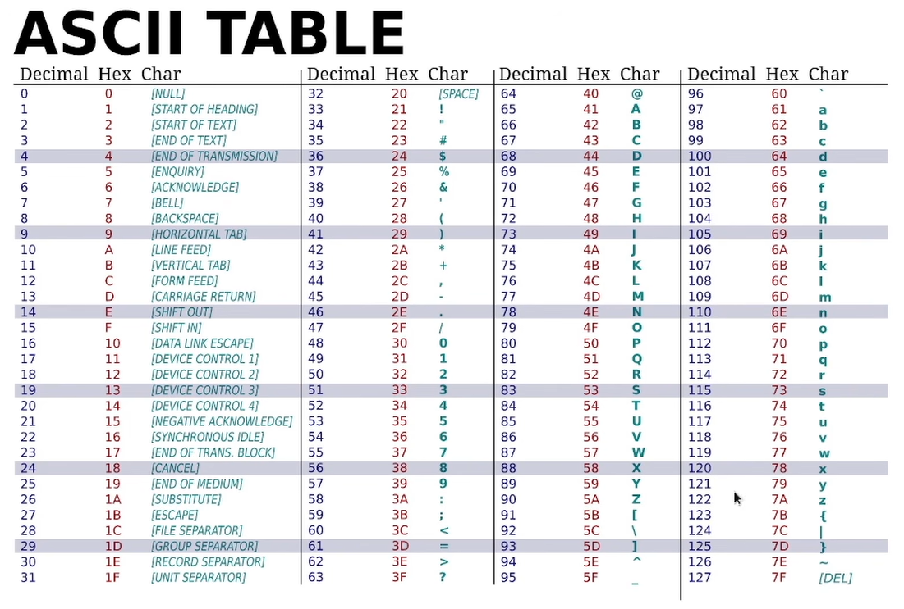

# Numbers - Integer Types

- **Signed Integer:** It can represent both positve and negative intergers
- **Unsigned Integer:** Always used to represent postivie integers


| Length | Signed | Unsigned |
| :---     | :---:    | ---:     |
| 8-bit     | i8   | u8   |
| 16-bit    | i16     | u16     |
| 32-bit     | i32   | u32   |
| 64-bit     | i64   | u64   |
| 128-bit     | i128   | u128   |
| arch     | isize   | usize   |
    

# Integers - Default Types

- Integer: i32
- Floats: f64


# Numbers - Binary Number systems

### 42
| **4** | **2** |
| :---     | :---:  |
| 10<sup>1</sup>    | 10<sup>0</sup>   |

(4x10<sup>1</sup>) + (2x10<sup>0</sup>)

= (4x10) + (2x1)

= 40 + 2 = **42**


### 42
| **0** | **0** | **1** | **0** | **1** | **0** | **1** | **0** |
| :---     | :---:  | :---     | :---:  | :---     | :---:  | :---     | :---:  |
| 2<sup>7</sup>    | 2<sup>6</sup>   | 2<sup>5</sup>   | 2<sup>4</sup>   | 2<sup>3</sup>   | 2<sup>2</sup>   | 2<sup>1</sup>   | 2<sup>0</sup>   |
| 128    | 64  | 32  | 16  | 8  | 4   | 2  | 1  |


(1x2<sup>5</sup>) + (1x2<sup>3</sup>) + (1x2<sup>1</sup>) 

= (1x32) + (1x8) + (1x2)

= 32 + 8 + 2 = **42**

- Smallest possible 8-bit integer (unsigned): **0**
  
- largest possible 8-bit integer (unsigned): **255**


- Smallest possible 16-bit integer (unsigned): **0**
  
- largest possible 16-bit integer (unsigned): **65,535**


# Numbers - Signed Integers
### 42

It will take the number 42 in the binary form and then invert all the values

| **0** | **0** | **1** | **0** | **1** | **0** | **1** | **0** |
| :---     | :---:  | :---     | :---:  | :---     | :---:  | :---     | :---:  |

| **1** | **1** | **0** | **1** | **0** | **1** | **0** | **1** |
| :---     | :---:  | :---     | :---:  | :---     | :---:  | :---     | :---:  |

After this add one  
| **1** | **1** | **0** | **1** | **0** | **1** | **1** | **0** |
| :---     | :---:  | :---     | :---:  | :---     | :---:  | :---     | :---:  | 
This gives the finaly output -42

<!--
Source - https://stackoverflow.com/a/57949762
Posted by nevzatseferoglu, modified by community. See post 'Timeline' for change history
Retrieved 2026-10-30, License - CC BY-SA 4.0
-->

## Number systems Size Limits


# Numbers - usize & isize
- Architecture dependent
- On 32-bit architecture: 32-bit
- On 64-bit architecture: 64-bit
- Pointer sized integer type, matches size of a word in a given platform
  

# Numbers - What is a word?
- Processor does NOT read 1 byte at a time from memory, it reads 1 word at a time
- In a 32-bit processor it can access 4 bytes (32 bits at a time)
- In a 64-bit processor it can access 8 bytes (64 bits at a time)


- In a 32-bit architecture the size of a word is 4 bytes, which means that the processor can access 4 bytes at a time.
  
- **usize** gives you the guarantee to be always big enough to hold any pointer or any offset in a data structure


# Numbers - Floating Point

- f32 - Size of 32 bits
- f64 - size of 64 bits
*This representation of floating point is given under IEEE-754 Specification*


```rust
fn main() {
    let x: i32 = 5;
    let mut y = 5; //i32  automatically assigns i32

    y = x;

    let z: i32 = 10; 

    println!("Success");
}
```


```rust
fn main() {
    let v: u16 = 38_u8 as u16;
    

    // We can also directly annote the type on the value like _u8 is the type assigned to the value 38
    println!("Success")
}
```
- 38_u8: the number 38 with its type attached. _u8 means it’s an 8-bit unsigned integer.    The _ is just for readability.
- as u16: converts the value to another type. Rust never converts number types on its own, so you must do it yourself.
- let v: u16: says the variable v is a u16.

- The _u8 tells the compiler that this number literal is a u8 (unsigned 8-bit integer). The underscore is just a visual separator, so 38u8 and 38_u8 mean the same thing.


**Note** If we dont explicitly assign a type to a variable, then the compiler will infer one for us.

```rust
fn main() {
    let x: u32 = 5;
    assert_eq!("i32".to_string(), type_of(&x));

    //&x is a reference to x

    println!("Success");
}

// Get the type of given variable, return a string representation of the type. For example:

fn type_of<T>(_: &T) -> String {
    format!("{}", std::any::type_name::<T>()) // When we call this function it just gives the name of the function. // We would get back the value "i32"
}


```
- &x borrows x without taking it.
- type_of<T> works for any type because T is generic.
- type_name::<T>() returns the type’s name as text.
- assert_eq! panics if the two sides differ, so “Success” prints only if the type is u32.
- Try changing u32 to i32 in let x. The assert will fail and panic.

```rust
// Fill the blanks to make it work
fn main() {
    assert_eq!(i8::MAX, 127); 
    assert_eq!(u8::MAX, 255); 
    // ADDED 127, 255
    println!("Success!");
}

```


```rust

// Fix errors and panics to make it work
fn main() {
   //let v1 = 251_u8 + 8;
   //  In the above case the compiler will infer the types
   //let v1: u8 = 251_u8 + 8_u8;
    // The problem is u8 will only have max of 255, so we change it to the next bigger datatype
   let v1 = 251_u16 + 8;

   let v2 = i16::checked_add(251, 8).unwrap(); // this is the same as the above but in a safer way. 
   println!("{},{}",v1,v2);
}

```

OUTPUT: 259, 259

<hr>


```rust
fn main() {
    let v = 1_024 + 0xff + 0o77 + 0b1111_1111;
    // 1_024 is in decimal
    // 0xff is in hexadecimal
    // 0o77 is in octal
    // 0b1111_1111 is in binary

    // After converting it will be  1024 + 255 +  63 + 255 = *1579*
    assert!(v == 1579);

    println!("Success!");
}
```
- This proves that in rust you can perform mathematical operations on different number systems.


## Floating Point 

```rust
fn main() {
    let x: f64 = 1_000.000_1; //f64 
    // *Note:* In the following above line 1_0, the underscore is used to display a seperator like a comma.

    let y: f32 = 0.12; // f32
    let z = 0.01_f64; // f64

    assert_eq!(type_of(&x), "f64".to_string());
    println!("Success!");

    //f64 is the return value
}

fn type_of<T>(_: &T) -> String {
    format!("{}", std::any::type_name::<T>())
}
```
**NOTE: THE BELOW PROGRAM WONT GIVE THE RIGHT OUTPUT**
```rust

fn main() {
    assert!(0.1+0.2==0.3);

    println!("Success!");
}
```
**Reason:** this is because the floating point numbers have a very high precision and will return something like 0.3000000000002

- So to fix it, we do this

```rust

fn main() {
    assert!(0.1_f32+0.2_f32==0.3_f32);
    
    // Can also be written as assert!(0.1 as f32+0.2 as f32==0.3 as f32);  

    println!("Success!");
}
```


## Range

```rust
fn main() {
    let mut sum: i32 = 0;
    for i in -3..2 {
        sum += i
    } 

    assert!(sum == -3);

    for c in 'a'..='z' {
        println!("{}",c);
        //IN THIS WE ARE DEFINING A LOOP FROM A-Z
    }
}

```
- Here the for loop, iterates over some defined range, and we are executing a intruction multiple times, basically the times we are iterating over the specified range, each iteration the value of i will hold different values, from -3 to 1 since 2 in a for loop is excluded

**NOTE:** IN THE FOR LOOP THE END VALUE WILL ALWAYS BE IGNORED I.E -3..2 WILL ITERATE [-3, -2, -1, 0 , 1]




## Using Libraries for Range

In Rust, we can use the `std::ops` library to work with different types of ranges.

There are two types:
- **Range:** Uses `..` and excludes the ending value.
- **RangeInclusive:** Uses `..=` and includes the ending value.

```rust

use std::ops::{Range, RangeInclusive};

fn main() {
    assert_eq!((1..5), Range { start: 1, end: 5 });

    assert_eq!((1..=5), RangeInclusive::new(1, 5));

    println!("Success!");
}
```
Explanation:
- use std::ops::{Range, RangeInclusive};
  - Here we are importing Range and RangeInclusive from the standard library.
  - std stands for standard library.
  - ops contains types related to operations, including ranges.
- Range:
  - Represents a range where the ending value is excluded.
  - For example, 1..5 represents 1, 2, 3, 4.
  - The number 5 is not included.
- Range { start: 1, end: 5 }:
  - Here we are manually defining a range.
  - start: 1 means the range starts from 1.
  - end: 5 means the range ends at 5, but 5 is excluded.
- RangeInclusive:
  - Represents a range where the ending value is included.
  - For example, 1..=5 represents 1, 2, 3, 4, 5.
- RangeInclusive::new(1, 5):
  - This creates an inclusive range starting from 1 and ending at 5.
  - Both 1 and 5 are included.
- assert_eq!:
  - Checks whether the two values on either side are equal.
  - If they are not equal, the program will panic.


## Operators in Rust

In Rust, operators are used to perform different operations on values and variables, such as addition, subtraction, multiplication, division, comparison, and logical operations.

### 1. Arithmetic Operations

```rust
// Fill the blanks and fix the errors

fn main() {
    // Integer addition
    assert!(1u32 + 2 == 3);

    // Integer subtraction
    assert!(1i32 - 2 == -1);

    // Integer multiplication
    assert!(3 * 50 == 150);

    // Floating-point division
    assert!(9.6_f64 / 3.2_f64 == 3.0);

    // Modulus (remainder)
    assert!(24 % 5 == 4);

    println!("Success!");
}
```

**Explanation:**

- `+` : Used for addition.
  - `1 + 2 = 3`

- `-` : Used for subtraction.
  - `1 - 2 = -1`

- `*` : Used for multiplication.
  - `3 * 50 = 150`

- `/` : Used for division.
  - `9.6 / 3.2 = 3.0`
  - Here we use floating-point numbers (`f64`).

- `%` : Used to find the remainder after division.
  - `24 % 5 = 4`
  - This is because 5 goes into 24 four times, leaving a remainder of 4.

**IMPORTANT:** Rust does not automatically convert number types. For example, `u32` and `i32` are different types.

Also, `u8` can only store values from 0 to 255. Therefore:

```rust
assert!(1u8 - 2 == -1);
```

The above statement will not work because `u8` is an unsigned integer and cannot store negative values. In debug mode, this subtraction causes an overflow panic.

### 2. Short-Circuiting Boolean Logic

Boolean operations are used to check conditions. They return either `true` or `false`.

```rust
fn main() {
    assert!(true && false == false);

    assert!(true || false == true);

    assert!(!true == false);

    println!("Success!");
}
```

**Explanation:**

- `&&` (AND):
  - Returns `true` only when both conditions are true.
  - If even one condition is false, the result will be false.

- `||` (OR):
  - Returns `true` if at least one condition is true.
  - Returns false only when both conditions are false.

- `!` (NOT):
  - Reverses the Boolean value.
  - If the value is true, it becomes false.
  - If the value is false, it becomes true.

**NOTE:** Short-circuiting means Rust may skip evaluating the second condition if the result is already determined by the first condition.

### 3. Bitwise Operations

Bitwise operations work directly on the individual bits (0s and 1s) of integer values.

```rust
fn main() {
    // Bitwise operations
    println!("0011 AND 0101 is {:04b}", 0b0011u32 & 0b0101);

    println!("0011 OR 0101 is {:04b}", 0b0011u32 | 0b0101);

    println!("0011 XOR 0101 is {:04b}", 0b0011u32 ^ 0b0101);

    println!("1 << 5 is {}", 1u32 << 5);

    println!("0x80 >> 2 is 0x{:x}", 0x80u32 >> 2);
}
```
### 4. Important Formatting Symbols

Rust uses different formatting symbols inside `println!()`.

| Symbol | Meaning |
|---|---|
| `{}` | Displays the normal value |
| `{:b}` | Displays the value in binary |
| `{:04b}` | Displays binary using at least 4 digits, adding leading zeros if needed |
| `{:x}` | Displays the value in hexadecimal |
| `{:X}` | Displays the value in uppercase hexadecimal |

For example:

```rust
fn main() {
    println!("{:04b}", 5);
    println!("{:x}", 128);
}
```

**OUTPUT:**

```text
0101
80
```

**NOTE:** `0b` is used to represent binary numbers, whereas `0x` is used to represent hexadecimal numbers in Rust.


**IMPORTANT:** Remember that arithmetic operators work on numerical values, logical operators work on Boolean values (`true` and `false`), and bitwise operators work directly on the binary representation of integers.
<hr>
<hr>

# End of Module 2