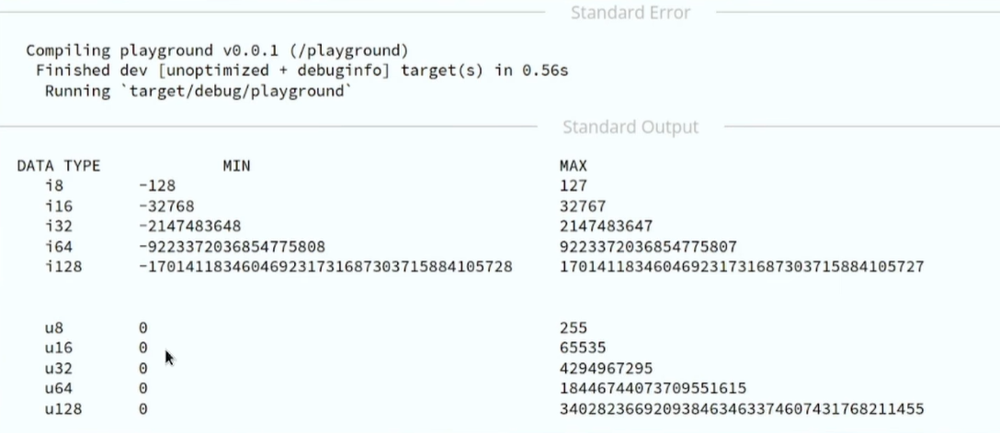
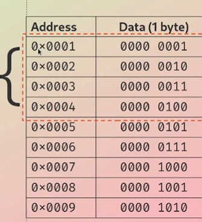

# Numbers - Integer Types

- **Signed Integer:** It can represent both positve and negative intergers
- **Unsigned Integer:** Always used to represent postivie integers


| Length | Signed | Unsigned |
| :---     | :---:    | ---:     |
| 8-bit     | i8   | u8   |
| 16-bit    | i16     | u16     |
| 32-bit     | i32   | u32   |
| 64-bit     | i64   | u64   |
| 128-bit     | i128   | u128   |
| arch     | isize   | usize   |


# Integers - Default Types

- Integer: i32
- Floats: f64


# Numbers - Binary Number systems

### 42
| **4** | **2** |
| :---     | :---:  |
| 10<sup>1</sup>    | 10<sup>0</sup>   |

(4x10<sup>1</sup>) + (2x10<sup>0</sup>)

= (4x10) + (2x1)

= 40 + 2 = **42**


### 42
| **0** | **0** | **1** | **0** | **1** | **0** | **1** | **0** |
| :---     | :---:  | :---     | :---:  | :---     | :---:  | :---     | :---:  |
| 2<sup>7</sup>    | 2<sup>6</sup>   | 2<sup>5</sup>   | 2<sup>4</sup>   | 2<sup>3</sup>   | 2<sup>2</sup>   | 2<sup>1</sup>   | 2<sup>0</sup>   |
| 128    | 64  | 32  | 16  | 8  | 4   | 2  | 1  |


(1x2<sup>5</sup>) + (1x2<sup>3</sup>) + (1x2<sup>1</sup>) 

= (1x32) + (1x8) + (1x2)

= 32 + 8 + 2 = **42**

- Smallest possible 8-bit integer (unsigned): **0**
  
- largest possible 8-bit integer (unsigned): **255**


- Smallest possible 16-bit integer (unsigned): **0**
  
- largest possible 16-bit integer (unsigned): **65,535**


# Numbers - Signed Integers
### 42

It will take the number 42 in the binary form and then invert all the values

| **0** | **0** | **1** | **0** | **1** | **0** | **1** | **0** |
| :---     | :---:  | :---     | :---:  | :---     | :---:  | :---     | :---:  |

| **1** | **1** | **0** | **1** | **0** | **1** | **0** | **1** |
| :---     | :---:  | :---     | :---:  | :---     | :---:  | :---     | :---:  |

After this add one  
| **1** | **1** | **0** | **1** | **0** | **1** | **1** | **0** |
| :---     | :---:  | :---     | :---:  | :---     | :---:  | :---     | :---:  | 
This gives the finaly output -42

<!--
Source - https://stackoverflow.com/a/57949762
Posted by nevzatseferoglu, modified by community. See post 'Timeline' for change history
Retrieved 2026-10-30, License - CC BY-SA 4.0
-->

## Number systems Size Limits


# Numbers - usize & isize
- Architecture dependent
- On 32-bit architecture: 32-bit
- On 64-bit architecture: 64-bit
- Pointer sized integer type, matches size of a word in a given platform
  

# Numbers - What is a word?
- Processor does NOT read 1 byte at a time from memory, it reads 1 word at a time
- In a 32-bit processor it can access 4 bytes (32 bits at a time)
- In a 64-bit processor it can access 8 bytes (64 bits at a time)


- In a 32-bit architecture the size of a word is 4 bytes, which means that the processor can access 4 bytes at a time.
  
- **usize** gives you the guarantee to be always big enough to hold any pointer or any offset in a data structure




# Numbers - Floating Point

- f32 - Size of 32 bits
- f64 - size of 64 bits
*This representation of floating point is given under IEEE-754 Specification*


```rust
fn main() {
    let x: i32 = 5;
    let mut y = 5; //i32  automatically assigns i32

    y = x;

    let z: i32 = 10; 

    println!("Success");
}
```


```rust
fn main() {
    let v: u16 = 38_u8 as u16;
    

    // We can also directly annote the type on the value like _u8 is the type assigned to the value 38
    println!("Success")
}
```
- 38_u8: the number 38 with its type attached. _u8 means it’s an 8-bit unsigned integer.    The _ is just for readability.
- as u16: converts the value to another type. Rust never converts number types on its own, so you must do it yourself.
- let v: u16: says the variable v is a u16.

- The _u8 tells the compiler that this number literal is a u8 (unsigned 8-bit integer). The underscore is just a visual separator, so 38u8 and 38_u8 mean the same thing.


**Note** If we dont explicitly assign a type to a variable, then the compiler will infer one for us.

```rust
fn main() {
    let x: u32 = 5;
    assert_eq!("i32".to_string(), type_of(&x));

    //&x is a reference to x

    println!("Success");
}

// Get the type of given variable, return a string representation of the type. For example:

fn type_of<T>(_: &T) -> String {
    format!("{}", std::any::type_name::<T>()) // When we call this function it just gives the name of the function. // We would get back the value "i32"
}


```
- &x borrows x without taking it.
- type_of<T> works for any type because T is generic.
- type_name::<T>() returns the type’s name as text.
- assert_eq! panics if the two sides differ, so “Success” prints only if the type is u32.
- Try changing u32 to i32 in let x. The assert will fail and panic.

```rust
// Fill the blanks to make it work
fn main() {
    assert_eq!(i8::MAX, 127); 
    assert_eq!(u8::MAX, 255); 
    // ADDED 127, 255
    println!("Success!");
}

```


```rust

// Fix errors and panics to make it work
fn main() {
   //let v1 = 251_u8 + 8;
   //  In the above case the compiler will infer the types
   //let v1: u8 = 251_u8 + 8_u8;
    // The problem is u8 will only have max of 255, so we change it to the next bigger datatype
   let v1 = 251_u16 + 8;

   let v2 = i16::checked_add(251, 8).unwrap(); // this is the same as the above but in a safer way. 
   println!("{},{}",v1,v2);
}

```

OUTPUT: 259, 259

<hr>


```rust
fn main() {
    let v = 1_024 + 0xff + 0o77 + 0b1111_1111;
    assert!(v == 1579);

    println!("Success!");
}
```


<hr>
<hr>

# End of Module 2